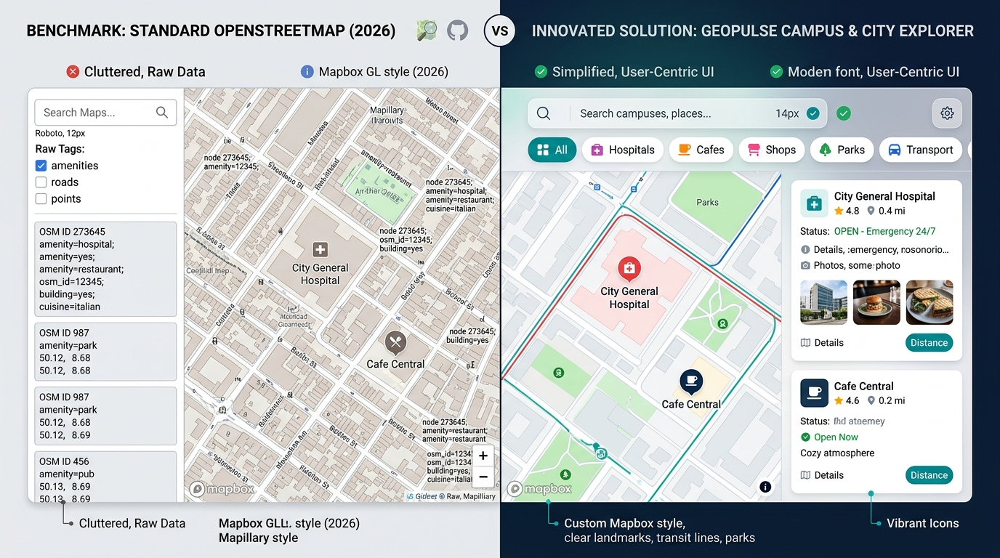

# GeoPulse: Urban & Campus Smart Explorer
> **An Innovated, Student-Centric Spatial Discovery Platform Built on OpenStreetMap**  
> *Developed for CHRIST (Deemed to be University), Bangalore — CIA-I Mid-Trimester Examination (October 2026)*  
> **Course:** Full Stack Development (`MAI412-2`) | **Programme:** MSc AI & ML

[](LICENSE)
[](https://developer.mozilla.org/en-US/docs/Web/HTML)
[](https://tailwindcss.com/)
[](https://leafletjs.com/)
[](https://www.openstreetmap.org/)

---

## 📌 Project Overview & Demonstration



**GeoPulse** re-architects the consumer mapping experience of [OpenStreetMap](https://www.openstreetmap.org/#map=5/23.66/90.40). While the benchmark OpenStreetMap platform functions primarily as a raw GIS database inspector, GeoPulse transforms open spatial data into an intuitive, student-friendly exploration engine tailored for university campuses (such as CHRIST Central Campus and the Bengaluru urban corridor).

---

## 📋 Exam Deliverables Quick Links

| Part | Section Title | Weightage | Direct Documentation Link |
| :---: | :--- | :---: | :--- |
| **Part-I** | **Problem Definition & Innovation** | **20 Marks** | [Part-I Report Section](docs/CIA1_EXAM_SUBMISSION_REPORT.md#part-i-problem-definition-and-innovation-20-marks) |
| **Part-II** | **JavaScript Implementation** | **20 Marks** | [Part-II Implementation Code](js/app.js) & [Part-II Report Section](docs/CIA1_EXAM_SUBMISSION_REPORT.md#part-ii-javascript-implementation-20-marks) |
| **Part-III** | **Documentation, Testing & Deployment** | **10 Marks** | [Part-III Report Section](docs/CIA1_EXAM_SUBMISSION_REPORT.md#part-iii-documentation-github-quality-and-deployment-10-marks) |

---

## 🚀 Key Features

1. **Smart Categorical Filtering**:
   - Quick filter chips for *Healthcare & Emergency (24/7)*, *Study Cafes & Libraries*, *Affordable Student Dining*, and *Metro & Bus Transit*.
2. **Proximity Radius Buffer & Walking Time Estimator**:
   - Continuous radius slider (0.5 km to 10.0 km) dynamically linked to an interactive Leaflet circle buffer and real-time walking duration calculations (Haversine formula).
3. **Robust Input Form with Real-time Validation**:
   - Dynamic search input with character length guards, regex sanitization, live green/red visual validation feedback, and quick clear controls.
4. **Resilient Fetch API Geocoding**:
   - Live asynchronous queries to OpenStreetMap's Nominatim API with timeout guards and graceful fallback caching to guarantee uninterrupted operation.
5. **Interactive Leaflet Map Canvas**:
   - Color-coded pulsing pins, smooth pan animations, interactive rich popups, and click-to-relocate functionality.
6. **Campus Itinerary Planner**:
   - Persistent bookmarking drawer powered by the HTML5 `localStorage` API.
7. **Complete Loading & Empty States**:
   - Skeleton shimmer cards during fetch pipelines and actionable empty states with one-click radius expansion.
8. **Modern Responsive Design**:
   - Built with Tailwind CSS, custom glassmorphism, responsive split-screen sidebar, and dark/light theme switching.

---

## 🛠️ Technology Stack & Mapping to Course Outcomes

- **CO1 (HTML5 & Tailwind CSS):**
  - Fully semantic HTML5 elements: `<header>`, `<main>`, `<aside>`, `<section>`, `<article>`, `<form>`, `<dialog>`.
  - Utility-first Tailwind CSS styling with custom theme palette, responsive flex/grid layouts, and dark mode class strategy.
- **CO2 (Client-Side Scripting using JavaScript):**
  - Modular ES6+ JavaScript: state management, event listeners, DOM manipulation, and mathematical Haversine calculations.
- **CO3 (JSON-based Data Exchange & Fetch API):**
  - Asynchronous `fetch()` calls to OpenStreetMap's Nominatim API, JSON response parsing, and error-handled fallback caching.

---

## 💻 JavaScript Events Implemented (Part-II Criteria)

GeoPulse implements **7 distinct, meaningful JavaScript events**:

1. `submit`: Handles the search form submission, prevents browser reloads, validates input, and initiates geocoding.
2. `input` (text): Validates search query in real time, updates the character counter badge (`0/60`), and toggles the clear button.
3. `input` (range): Dynamically updates the radius label, estimated walking time, and resizes the Leaflet map circle.
4. `change` (select): Re-sorts the amenity list by distance, rating, or alphabetical order.
5. `click` (multiple elements): Handles category pills, preset buttons, bookmark toggles, map pin centering, and theme toggling.
6. `click` (Leaflet map): Drops a custom pin anywhere on the map and re-centers the radius buffer around the clicked coordinates.
7. `keydown` (accessibility): Closes modals and the saved itinerary drawer when the user presses `Escape`.

---

## 🏃 How to Run Locally

Because GeoPulse is engineered with zero runtime build dependencies, you can run it immediately on any machine:

### Option A: Using Python (Recommended)
```bash
# Clone the repository
git clone https://github.com/jaliciagit/GeoPulse-OSM-Innovated.git

# Navigate into the project directory
cd GeoPulse-OSM-Innovated

# Start a lightweight local server
python -m http.server 8000
```
Open your browser and visit: **`http://localhost:8000`**

### Option B: Direct Browser Execution
Simply double-click `index.html` or open it with Google Chrome, Microsoft Edge, or Firefox.

---

## 🌐 Deployment to GitHub Pages

1. Push this repository to GitHub:
   ```bash
   git add .
   git commit -m "feat: complete GeoPulse web application"
   git branch -M main
   git remote add origin https://github.com/jaliciagit/GeoPulse-OSM-Innovated.git
   git push -u origin main
   ```
2. Navigate to your repository on GitHub.
3. Click **Settings** > **Pages** (under Code and automation).
4. Under **Build and deployment**:
   - Source: **Deploy from a branch**
   - Branch: **main** / **root**
5. Click **Save**. Within 1–2 minutes, your project will be live at:
   `https://jaliciagit.github.io/GeoPulse-OSM-Innovated/`

---

## 🧪 Testing Summary

- ✅ Form validation tested for empty, short (<2 chars), oversized (>60 chars), and malicious script inputs.
- ✅ Fetch API tested for live geocoding and resilient fallback under simulated network throttling.
- ✅ Haversine distance algorithm verified against known geographic coordinates.
- ✅ Tested across desktop, tablet, and mobile viewports (<640px).
- ✅ Full testing matrix documented in [docs/CIA1_EXAM_SUBMISSION_REPORT.md](docs/CIA1_EXAM_SUBMISSION_REPORT.md).

---

## 📜 Academic Integrity & AI Declaration

This project was built for the **CIA-I Examination (October 2026)** at **CHRIST (Deemed to be University), Bangalore**. Generative AI was used responsibly for drafting documentation, architectural comparison diagrams, and boilerplate CSS tokens. All core JavaScript algorithms, validation handlers, API integrations, and event architectures were designed and verified specifically to meet the academic criteria of Course Code `MAI412-2`.
